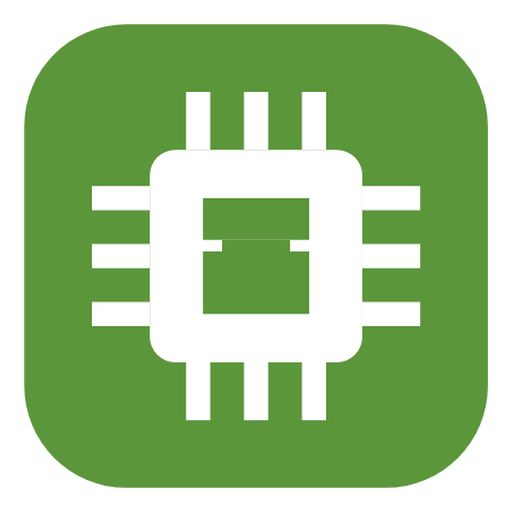

# forte-runtime
Eclipse 4diac FORTE with ModLib built in, per platform (Raspberry Pi, PC): the builds, the patches, the installer and the kit for your own blocks.

| What | Where |
| --- | --- |
| The Raspberry Pi's FORTE (aarch64, stripped) and its checksum | `bin/forte-aarch64`, `bin/forte-aarch64.sha256` |
| Make a Pi an IEC 61499 PLC: Docker, FORTE in a container that starts with the machine, the GPIO lines and PWM channels | `install.sh` (the container's files are `pi/` in [deploy](https://github.com/AAU-AASPIRE/deploy)) |
| Build FORTE with ModLib and every module's types, for this PC or the Pi (4diac FBE) | `build-modules.ps1`, `build-runtime.ps1`, `build-pi.ps1`, `fbe/` |
| Our changes to FORTE 3.3 (IO handles, sysfs PWM, GPIO inputs, LDS registration only when asked, ...) | `forte-patches/` |
| Check and export a 4diac project; a boot file from it; deploy it to a Pi | `validate.ps1`, `check-project.ps1`, `make-bootfile.ps1`, `deploy-pi.ps1`, `update-pi.ps1` |
| The offline kit for students | `make-kit.ps1`, `kit/` |

```bash
curl -fsSL https://raw.githubusercontent.com/AAU-AASPIRE/forte-runtime/main/install.sh | bash   # on the Pi
```

```powershell
.\build-modules.ps1                       # FORTE for this PC with every module (modgen from aaspire-tools, the line's specs)
.\build-pi.ps1                            # ... for the Pi, into bin/forte-aarch64
```

The scripts find the line's projects in the aseptic line beside this repository
(`AAU-AASPIRE/aseptic-line/cell/control`). FORTE itself is Eclipse 4diac FORTE (EPL-2.0); the patches
and scripts here are MIT. Part of [AASPIRE](https://github.com/AAU-AASPIRE/aaspire).
